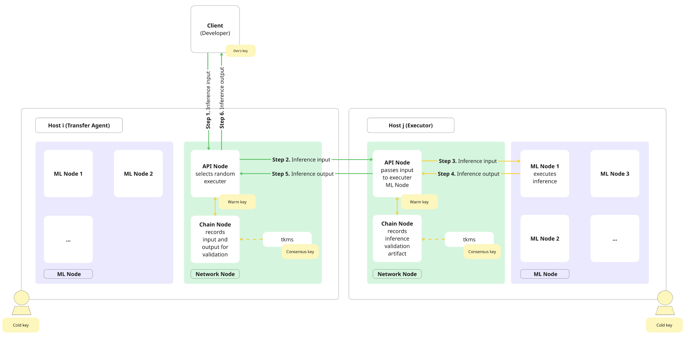
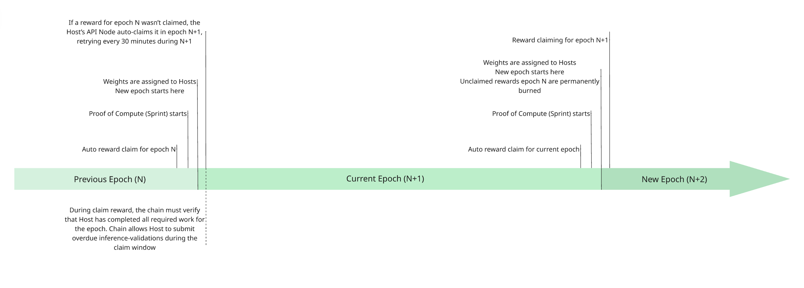

# Architecture

## Inference flow across Gonka

The diagram and description below outline how inference requests travel through Gonka, a decentralized network designed to balance performance with cryptographic guarantees. 
Gonka only records transactions and artifacts for inference validation. The actual computation happens off-chain.

Inference requests move across independent Hosts (all network participants, not a central scheduler). The system is decentralized, with no single point directing inference requests to the network nodes. In practice, each Host deploys at least two nodes: 

- Network Node handles communication and consists of: 
    - a Chain Node that connects to the blockchain
    - an API Node that manages user requests
- One or more ML Nodes (inference) which perform LLM inferences (ML Nodes could be deployed across multiple servers).

The diagram below shows the flow of an inference request through the Gonka network. Green arrows indicate communication over the public internet, while yellow arrows indicate communication within a Host’s private network.

The following sequence describes how an inference request moves through the Gonka network as illustrated in the diagram above:

- **Step 1.** A Client (Developer) selects a random node from the list of active participants (Hosts). This random Host acts as the Transfer Agent (TA) and gets an inference request to its API node. Any Host acts as Validator, TA and an Executor (these are not predefined or on-chain roles, but dynamic operational functions assumed when processing a request).
- **Step 2.** The TA randomly selects an Executor among all other active Hosts and passes the inference input to the Executor’s API node. In the meantime, the TA’s Chain Node records inference input on-chain. Note that the on-chain record does not hold back the LLM computation and is made in parallel with the work done by the Executor.
- **Step 3.** The Executor’s API node forwards the request to one of its ML Nodes, which begins running inference immediately.
- **Step 4.** Once computation is complete, the Executor’s ML Node returns the inference output to the Executor’s API node.
- **Step 5.** The Executor’s API node sends the output back to the TA’s API node, while the Executor’s Chain Node records a validation artifact on-chain.
- **Step 6.** The TA’s API node returns the output to the Client (Developer), while the TA’s Chain Node records it on-chain. Note that while these on-chain entries contribute to overall network bandwidth constraints, they don’t add overhead to a particular inference computation.

### Performance & Validation

Blockchain records are not slowing down either the moment when inference computation starts, nor the moment when final results are available to the client. The validation that inference was done honestly happens afterwards, in parallel with other inferences. If an Executor is caught cheating, they’ll lose rewards for the whole epoch, and the client will be notified and get their money back.
Note that the diagram shows inference flow on a high-level and does not show full complexity of the network. For example, it does not show direct communication between Hosts’ Chain Nodes, and does not include the bridge or several other internal components not relevant at this abstraction level.

## Proof of Compute (PoC) timeline

Proof or Compute is a novel consensus mechanism which retains all the benefits of traditional Proof of Work in terms of aligning weight, workload and rewards with computational power (unlike Proof of Stake which aligns weight with the staked coins). Unlike Proof of Work, Proof of Compute concentrates the proving part (Sprint) in a short limited time window, freeing the rest of the time for the useful work (in our case LLM inference). 
Gonka operates in epochs, each epoch lasts 15391 blocks (approximately 23 hours). 

Each epoch follows a strict sequence that ties Sprint execution, Hosts activity, and reward settlement into a cohesive flow. 

Each Sprint begins simultaneously for all Hosts, ensuring fairness by eliminating any advantage based on timing (much like a starting gun in a race, where no Host may begin early). This synchronous start is coordinated using a random seed that cannot be predicted or influenced beforehand. All Hosts with voting power contribute to generating this seed, preventing any minority set of Hosts from pre-computing or gaining an unfair edge. 

Sprints are deliberately short, concentrating computational effort into a tightly bounded and efficient window. They occur at regular, precisely defined intervals aligned with blockchain block production, taking only a small fraction of the total epoch length. By design, Spring duration is minimized so that the majority of epoch remains available for meaningful work, such as LLM inference and training. This predictable rhythm allows Sprint execution to integrate naturally into the overall operation of the decentralized AI network without interfering with productive workloads.

An epoch concludes with auto claiming rewards for epoch N. The new Proof of Compute phase (Sprint) begins to determine Hosts weights for the upcoming Epoch. Once Sprint is completed and weights are assigned, this marks the start of the new epoch.

Throughout the epoch, Hosts run and validate inferences. 

If for some reason a reward for epoch N was not claimed, each Host’s API node automatically submits a reward claim transaction in epoch N+1 for epoch N using the seed that was signed at the start of epoch N. The claim is retried every 30 minutes until it succeeds. Importantly, the Host must remain online and pass all verification checks within this limited window, otherwise, the chain cannot finalize the claim, and the reward remains unclaimed. Unclaimed rewards from earlier epochs  (epoch N) are permanently burned as soon as epoch N+2 begins.

As part of the claim process, the chain verifies that Host completed all required work for the epoch. The protocol also allows overdue inference-validation artifacts to be submitted during this window, giving Hosts a final opportunity to execute any pending validations before rewards are finalized.

## Devshards: taking inference off the critical path of consensus

The natural implementation puts the record on the blockchain: inference accounting as ordinary transactions, so that each request is opened, closed and validated on-chain and every participant can see who was asked, who answered, and what was owed. This is correct, and it is also self-limiting. A block holds a bounded number of transactions and arrives at a fixed cadence, so a network that spends several transactions per inference has a ceiling on inferences per second that is a property of its blockchain rather than of the hardware behind it. The ceiling is low: with realistic block parameters it is reached by a few hundred accelerators serving a large model — a fraction of the hardware the network already has, and a rounding error against the capacity it intends to have. Worse, it is not a ceiling that engineering can lift. Making per-inference processing a hundred times cheaper moves the wall further away without removing it, and every request that crosses the chain also becomes state that every full node must store and replay indefinitely.

This is a familiar problem, and it has a familiar family of answers. When a blockchain's throughput binds, the standard response is to move execution off the base layer and use the chain only for settlement — the approach known collectively as layer two. Devshards are Gonka's layer two, and it is worth saying at the outset which kind. They are not a rollup: nothing is posted to the chain for others to re-execute, and the base layer holds no data from which a session could be reconstructed. They belong to the older branch of the family, the one payment channels come from, in which a small group transacts among itself and brings the chain only a final balance. What ordinarily limits that design is that a channel's safety reaches no further than the parties inside it. Gonka escapes that limit by not letting the parties choose one another.

### The session as the unit of settlement

A devshard is a short-lived execution shard that exists for the duration of a single session between one source of demand and a small group of Hosts. Inside it, requests are executed, priced and accounted for without touching the blockchain. The blockchain sees the session twice: once when it opens, and once when it closes.
Opening a session is a transaction that locks a deposit — an escrow — and names the model to be served. In response, the chain deterministically samples a group of Hosts from those qualified for that model, each Host’s probability of being drawn proportional to the weight it earned in the last Sprint. This sampling is the hinge of the entire design. The group is not chosen by the customer, not chosen by the Hosts, and not negotiated; it is drawn by the chain from a distribution the chain itself established through Proof of Compute. The security of the session is therefore inherited from the security of the base layer rather than constructed separately.
Closing the session is a second transaction carrying an aggregate: how much work each Host in the group performed, what it is owed, and a cryptographic commitment to the session’s full history. The chain verifies the aggregate, pays the Hosts, and returns the unspent deposit. Between those two transactions the blockchain has no idea how many requests were served, and does not need to.

### Ordering without consensus

What happens inside a session is deliberately not a blockchain. Running consensus per request would reintroduce the very cost the design exists to avoid, and it is unnecessary, because a session has a natural sequencer: the party paying for it. Requests are numbered consecutively, and that number does for the session what block height does for a chain — it fixes the order. It also fixes responsibility: the number determines, by simple arithmetic over the sampled group, which Host is expected to execute the request. Work is therefore distributed across the group in proportion to how many slots each Host was drawn into, which is in turn proportional to its proven capacity.
Each step is a signed increment from the sequencer — only the account that locked the escrow may number and sign the log. Hosts do not sequence; they apply those increments to an identical deterministic state machine. Members that have processed the same increments hold the same state and can sign the same summary of it, so agreement is not negotiated continuously: it either holds or it does not, and it is checked once, at the end, when Hosts sign that summary. Members exchange lightweight notices of what they have seen, which is how a member that missed an increment discovers the gap, and how the group detects a sequencer trying to tell two members different things about the same position in the order.
Verification inside a session follows the same logic as verification on the main network: members re-execute a random sample of the work their peers performed, and a member who believes a result is wrong challenges it, which puts it to a vote among the group. Requests that are never answered time out and are recorded as unserved against the Host that should have answered them.

### Why the guarantees survive going off-chain

Settlement is where the guarantees are cashed in. The chain accepts a session’s closing aggregate only if it carries signatures from more than two-thirds of the group’s slots. Falsifying a settlement — inflating one Host’s earnings, hiding another’s failures, or under-reporting what the customer consumed — therefore requires controlling more than a third of the group's slots the chain sampled at random from the network-wide compute distribution. Doing that reliably requires owning a corresponding share of the network’s total proven compute, which is precisely the cost the base layer was built to impose. The attack does not become cheaper because the target is off-chain; it costs the same as attacking the chain, because it is the same attack.

The customer is constrained symmetrically. Because those increment signatures are under the escrow-owning key, two contradictory signatures for the same position are self-proving fraud by the owner of the funds, and the chain seizes the escrow. Hosts are not the sequencer: they ratify the summary, and the chain pays only on a matching quorum of that summary. And because the escrow is locked before any work is done, Hosts are never exposed to a customer who simply stops paying; the worst case is a session that ends early with the deposit distributed according to what was actually served.
The chain retains exactly the role it is good at. It holds the money, samples the participants, verifies the signatures, adjudicates disputes and pays. It does not read prompts, does not see responses, and does not store the traffic. Privacy improves as a side effect: the network’s permanent public record contains aggregates, not conversations.

### Why the shards are disposable

A permanent shard accumulates state, and state must be maintained, migrated and re-secured as membership changes; it must also be large enough to be secure on its own, which fragments the network’s security budget and creates the familiar problem of a shard weak enough to be captured. A per-session shard holds nothing but the session. It can be created and destroyed cheaply, groups can overlap arbitrarily, and a Host can belong to as many sessions at once as its hardware supports. Capacity then scales with the number of concurrent sessions — that is, with demand — while the chain’s workload scales only with the number of sessions opened and closed. The network’s throughput stops being a property of its blockchain and becomes, as it should be, a property of its GPUs.

One consequence of moving execution off the chain is that the software executing it can evolve on its own schedule. The rules a session follows are fixed when it opens, and the binaries permitted to run those rules are approved by governance and pinned by cryptographic hash, so a Host runs shard software the network has voted for and can serve several approved versions concurrently. Changing how sessions work therefore does not require coordinating an upgrade of every full node at a single block height, which is what makes it practical to iterate quickly on the part of the system that faces users most directly.
