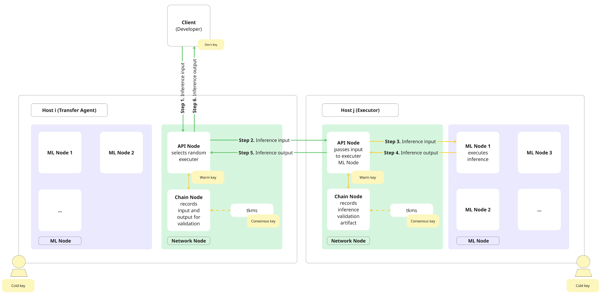
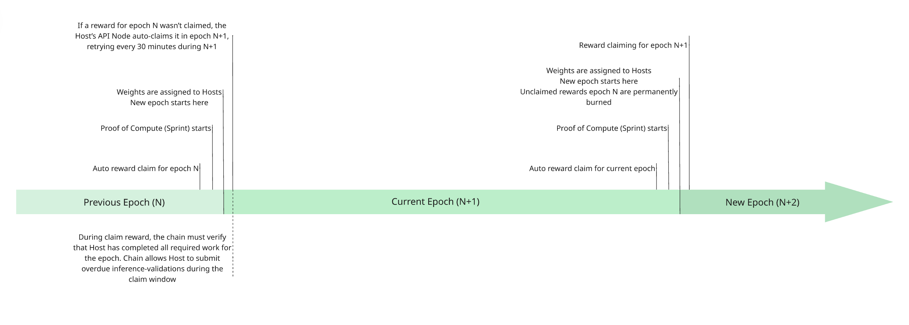

# 架构

## Gonka中的推理流程

下图及描述概述了推理请求如何通过Gonka传输，Gonka是一个旨在平衡性能与密码学保障的去中心化网络。
Gonka仅记录用于推理验证的交易和工件，实际计算发生在链下。

推理请求在独立的Host（所有网络参与者，而非中央调度器）之间流动。系统是去中心化的，没有单一节点负责将推理请求定向到网络节点。实际上，每个Host至少部署两个节点：

- 网络节点负责通信，包括：
    - 一个连接到区块链的链节点
    - 一个管理用户请求的API节点
- 一个或多个ML节点（推理），执行LLM推理（ML节点可部署在多个服务器上）。

下图展示了推理请求在Gonka网络中的流程。绿色箭头表示通过公共互联网的通信，黄色箭头表示在Host私有网络内的通信。

以下序列描述了推理请求如何按上述图示在Gonka网络中流动：

- **步骤1。** 客户端（开发者）从活跃参与者（Host）列表中随机选择一个节点。该随机Host作为传输代理（TA），将推理请求发送至其API节点。任何Host均可充当验证者、TA和执行者（这些并非预定义或链上角色，而是在处理请求时动态承担的操作功能）。
- **步骤2。** TA从所有其他活跃Host中随机选择一个执行者，并将推理输入传递给执行者的API节点。同时，TA的链节点将推理输入记录到链上。请注意，链上记录不会阻塞LLM计算，而是与执行者的计算并行进行。
- **步骤3。** 执行者的API节点将请求转发给其一个ML节点，该节点立即开始执行推理。
- **步骤4。** 计算完成后，执行者的ML节点将推理输出返回给其API节点。
- **步骤5。** 执行者的API节点将输出发送回TA的API节点，同时执行者的链节点在链上记录一个验证工件。
- **步骤6。** TA的API节点将输出返回给客户端（开发者），同时TA的链节点将其记录在链上。请注意，尽管这些链上条目会增加整体网络带宽负担，但不会对单次推理计算增加额外开销。

### 性能与验证

区块链记录不会延迟推理计算的启动时刻，也不会延迟客户端获取最终结果的时刻。推理是否诚实执行的验证发生在之后，并与其他推理并行进行。如果发现执行者作弊，他们将失去整个纪元的奖励，客户端将收到通知并获得退款。
请注意，该图仅以高层次展示推理流程，并未体现网络的全部复杂性。例如，它未显示Host间链节点的直接通信，也未包含桥接器或其他在此抽象层级无关的内部组件。

## 计算证明（PoC）时间线

证明或计算是一种新颖的共识机制，它保留了传统工作量证明（Proof of Work）在将权重、工作量和奖励与计算能力对齐方面的所有优势（与权益证明（Proof of Stake）将权重与质押代币对齐不同）。与工作量证明不同，证明计算（Proof of Compute）将证明部分（Sprint）集中在短暂且有限的时间窗口内，从而将其余时间释放用于有用的工作（在我们的情况下是LLM推理）。
Gonka以纪元（epoch）为单位运行，每个纪元持续15391个区块（约23小时）。

每个纪元都遵循一个严格的序列，将Sprint执行、主机活动和奖励结算整合为一个连贯的流程。

每个Sprint对所有主机同时开始，通过消除基于时间的任何优势来确保公平性（类似于赛跑中的发令枪，任何主机不得提前开始）。这种同步启动由一个无法提前预测或影响的随机种子协调。所有具有投票权的主机共同参与生成该种子，防止任何少数主机集提前计算或获得不公平优势。

Sprint被有意设计得非常短暂，将计算努力集中在紧密界定且高效的窗口内。它们以与区块链区块生成对齐的规律、精确间隔发生，仅占整个纪元长度的一小部分。根据设计，Sprint的持续时间被最小化，以便大部分纪元时间可用于有意义的工作，例如LLM推理和训练。这种可预测的节奏使Sprint执行能够自然地融入去中心化AI网络的整体运行中，而不干扰生产性工作负载。

纪元结束时自动申领第N个纪元的奖励。新的证明计算阶段（Sprint）开始，以确定下一个纪元的主机权重。一旦Sprint完成并分配权重，即标志着新纪元的开始。

在整个纪元期间，主机运行并验证推理。

如果由于某种原因第N个纪元的奖励未被申领，每个主机的API节点将在第N+1个纪元中自动提交针对第N个纪元的奖励申领交易，使用在第N个纪元开始时签署的种子。该申领每30分钟重试一次，直到成功为止。重要的是，主机必须在此有限窗口内保持在线并通过所有验证检查，否则链无法最终确认申领，奖励将保持未申领状态。在第N+2个纪元开始时，更早纪元（第N个纪元）的未申领奖励将被永久销毁。

作为申领过程的一部分，链会验证主机是否完成了该纪元所需的所有工作。协议还允许在该窗口内提交逾期的推理-验证工件，为主机提供最后一次执行待处理验证的机会，然后再最终确定奖励。

## Devshards：将推理移出共识的关键路径

自然的实现方式是将记录放在区块链上：将推理核算作为普通交易，使得每个请求都在链上打开、关闭和验证，每个参与者都能看到谁被请求、谁应答以及欠款情况。这是正确的，但它也是自我限制的。一个区块承载的交易数量有限，且以固定节奏到达，因此每推理消耗多个交易的网络，其每秒推理上限取决于其区块链而非背后的硬件。这个上限很低：使用现实的区块参数，仅需几百个加速器服务一个大模型即可达到上限——这远低于网络已有的硬件数量，也远低于其预期容量。更糟的是，这不是可以通过工程手段提升的上限。将每个推理的处理成本降低一百倍，只是将墙推得更远，而没有消除它；每个穿越链的请求都会成为每个全节点必须无限存储和重放的状态。

这是一个熟悉的问题，也有熟悉的解决方案。当区块链吞吐量受限时，标准做法是将执行移出基础层，仅使用链进行结算——这就是所谓的第二层（layer two）。Devshards是Gonka的第二层，有必要一开始就说明它的类型。它们不是Rollup：没有任何内容被发布到链上供他人重新执行，基础层也不保存可用于重建会话的数据。它们属于更古老的分支，即支付通道所属的类型，其中一小群参与者彼此交易，仅向链提交最终余额。通常限制这种设计的是，通道的安全性仅限于其内部参与者。Gonka通过不让参与者自行选择彼此来规避这一限制。

### 会话作为结算单位

Devshard是一个短暂的执行分片，仅存在于单个请求源与一组主机之间的会话期间。在其中，请求被执行、定价和核算，而无需接触区块链。区块链仅在会话打开和关闭时看到它两次。
打开会话是一个锁定存款（托管）并指定要服务模型的交易。作为回应，链根据上一个Sprint中获得的权重，从符合条件的主机中确定性地抽样出一组主机，每个主机被抽中的概率与其权重成正比。这种抽样是整个设计的枢纽。该组不是由客户选择，不是由主机选择，也不是协商得出的；而是由链从其通过证明计算建立的分布中随机抽取的。因此，会话的安全性继承自基础层的安全性，而非独立构建。 
关闭会话是第二个交易，包含聚合信息：每组主机完成的工作量、应得报酬，以及对会话完整历史的加密承诺。链验证该聚合，支付主机，并返还未使用的存款。在这两次交易之间，区块链不知道服务了多少请求，也不需要知道。

### 无需共识的排序

会话内部的设计故意不是区块链。为每个请求运行共识会重新引入该设计旨在避免的成本，而且这是不必要的，因为会话有一个天然的排序器：支付方。请求按连续编号，该编号在会话中起到与区块链中区块高度相同的作用——固定顺序。它也固定了责任：该编号通过简单的算术运算，根据抽样组确定哪个主机应执行请求。因此，工作按每个主机被抽中的槽数比例分配，而槽数又与其证明的算力成正比。 
每个步骤都是由排序器签署的递增操作——只有锁定托管账户的主体才能编号并签署日志。主机不进行排序；它们将这些递增应用到一个相同的确定性状态机上。处理了相同递增的成员将拥有相同的状态，并可签署相同的状态摘要，因此共识无需持续协商：它要么成立，要么不成立，仅在最后由主机签署摘要时进行一次检查。成员之间交换轻量级通知，说明他们看到的内容，这使得错过某个递增的成员能够发现缺口，也使组能够检测排序器是否向两个成员传递了关于同一顺序位置的不同信息。 
会话内的验证遵循与主网络相同的逻辑：成员重新执行其同行执行的随机样本工作，若某成员认为结果错误，则提出挑战，由组内投票决定。未被应答的请求超时，并记录为应答主机的未服务记录。

### 为什么保证在离链后依然有效

结算才是保证兑现的地方。链仅在会话关闭聚合信息包含来自组内三分之二以上槽数的签名时才接受。伪造结算——夸大某主机收益、隐藏另一主机的失败、或低估客户消耗量——因此需要控制链从全网算力分布中随机抽样的组内超过三分之一的槽数。可靠地做到这一点需要拥有网络总证明算力的相应份额，而这正是基础层设计所要施加的成本。攻击并不会因为目标是离链的而变得更便宜；它与攻击链的成本相同，因为这就是同一攻击。

客户同样受到约束。由于这些递增签名由托管账户密钥控制，同一位置的两个矛盾签名即为资金所有者自证欺诈，链将没收托管资金。主机不是排序器：它们确认摘要，链仅在匹配的多数签名下支付。并且由于托管资金在任何工作开始前就被锁定，主机永远不会面临客户停止付款的风险；最坏的情况是会话提前结束，存款按实际服务量分配。 
链保留了它最擅长的角色：持有资金、抽样参与者、验证签名、裁决争议和支付。它不读取提示，不查看响应，也不存储流量。隐私作为副作用得到提升：网络的永久公共记录包含聚合信息，而非对话。

### 为什么分片是可丢弃的

永久分片会累积状态，而状态必须在成员变动时进行维护、迁移和重新保护；它还必须足够大以确保自身安全，这会分散网络的安全预算，并引发分片过于薄弱而被掌控的熟悉问题。会话分片仅保存会话内容，可以低成本创建和销毁，组可以任意重叠，主机可以同时参与其硬件支持的任意数量会话。容量因此随并发会话数量——即需求——而扩展，而链的工作负载仅随打开和关闭的会话数量变化。网络的吞吐量不再成为其区块链的属性，而应成为其GPU的属性。

将执行移出链的一个后果是，执行该软件可以按自己的节奏演进。会话遵循的规则在打开时即已固定，允许运行这些规则的二进制文件由治理批准并通过加密哈希锁定，因此主机运行的是网络投票通过的分片软件，并可同时服务多个经批准的版本。因此，更改会话的工作方式不再需要在单一区块高度协调所有全节点升级，这使得能够快速迭代系统中最直接面向用户的部分成为可能。
