!!! warning “桥暂时不可用”
    由于正在调查的事件，Gonka–Ethereum 桥已暂停使用。在进一步通知前，请勿使用该桥。请关注官方公告获取最新信息。

!!! warning 
    始终先进行小额测试交易。桥接转账不可逆，因此在转移大额资金前，请先发送小额资金并确认其正常到账。

    由 Gonka 共识控制的专用桥智能合约已部署在以太坊上的地址：

```text
0x972a7a92d92796a98801a8818bcf91f1648f2f68
```

---

# 通过仪表板桥接（UI 指南）

仪表板是桥接最简单的方式。它会为您处理密钥推导（参见 [Addresses and keys](addresses-and-keys.md)），因此您无需手动导入私钥或计算地址。

!!! tip 
    如果您不熟悉 CLI 或处理原始私钥，建议使用仪表板。如果您更倾向于手动操作，详细的 CLI 流程文档请参见 [Deposit USDT](deposit-usdt.md)、[Withdraw USDT](withdraw-usdt.md)、[Deposit GNK](deposit-gnk.md) 和 [Withdraw GNK](withdraw-gnk.md)。

## 仪表板为您做的事情

* **推导正确的地址。** 连接您用于桥接的以太坊钱包，仪表板会显示桥接将代币发送到的匹配 `gonka1…` 地址——因此您始终知道封装代币的接收地址。
* **警告种子短语账户。** 如果您使用的钱包的以太坊和 Gonka 密钥来自同一个 **助记词**，仪表板会检测到这一点并发出警告，因为种子推导的账户在每条链上使用不同的密钥——因此您的 Gonka 钱包默认不会显示桥接的代币。您仍然控制接收地址（您可以从同一助记词推导出匹配的密钥），但这需要额外的手动步骤。完整说明请参阅 [Addresses and keys](addresses-and-keys.md)。
* **显示您的桥接余额**，在“桥接资产”部分中，以便确认存款已到账。
* **报告链状态**，以便在发起转账前了解链是否处于降级状态。
* **提示桥接纪元更新**，当以太坊桥接落后于 Gonka 链时。如果您看到 **A Bridge needs epoch update**，请点击 **Update bridge** 提交缺失的纪元密钥。这是一个正常的以太坊交易，因此连接的钱包将支付 Gas 费用。参见 [Bridge epoch update](bridge-epoch-update.md)。

## 支持的流程

仪表板支持无需使用 CLI 的完整转账流程：

* **ETH 桥接** —— 将任何 ERC-20 代币（USDT、USDC、WETH 等）从以太坊存入 Gonka，或反向提现回以太坊。
* **GNK 桥接** —— 将原生 GNK 桥接到以太坊作为 WGNK，或反向操作。
* **IBC 桥接** —— 在 Gonka 和连接的 Cosmos 链（如 Kava）之间转移 IBC 原生代币（如 USDT）。

### 处理时间与费用

| 桥接类型 | 方向 | 处理时间 | 支付的 Gas |
|---|---|---|---|
| ETH 桥接（ERC-20） | 以太坊 → Gonka | ~15–20 分钟（等待以太坊最终确认） | ETH |
| ETH 桥接（ERC-20） | Gonka → 以太坊 | ~1–5 分钟 | ETH |
| GNK 桥接 | Gonka → 以太坊（铸造 WGNK） | ~1–5 分钟 | ETH |
| GNK 桥接 | 以太坊 → Gonka（销毁 WGNK） | ~15–20 分钟 | ETH |
| IBC | Kava → Gonka | ~1–3 分钟 | KAVA |
| IBC | Gonka → Kava | ~1–3 min | GNK（0 费用） |

---

## 将代币存入 Gonka

本部分将引导您使用桥接小工具将代币存入 Gonka。从 **代币** 下拉菜单中选择代币——小工具会自动检测桥接类型：

* **ERC-20 代币**（USDC、USDT、WETH 等）和 **GNK**（作为 WGNK）通过 **以太坊桥** 进行传输。
* **IBC 代币**（USDT <span class="md-tag">IBC</span> 等）通过 **IBC** 转移到连接的 Cosmos 链。

### ETH / GNK 桥接存款的工作原理

1. **在以太坊上锁定代币**——您的代币将发送至桥接合约并被锁定。
2. **验证者签名**——Gonka 验证者监控已完成的以太坊存款并收集 BLS 签名。
3. **在 Gonka 上铸造**——封装代币将在 Gonka 上铸造并发送至您的派生 `gonka1…` 地址。

### IBC 存款的工作原理

1. **在钱包中批准转账**——您签署来自源链（例如 Kava）的 IBC 转账。
2. **IBC 数据包中继**——数据包被中继至 Gonka。
3. **代币到达 Gonka**——IBC 代币将显示在您的 Gonka 钱包中。

### 打开仪表板

在浏览器中打开其中一个创世节点：

- [https://node1.gonka.ai:8443](https://node1.gonka.ai:8443)
- [https://node2.gonka.ai:8443](https://node2.gonka.ai:8443)

在左侧边栏中导航至 **开发者** 部分。您将在页面底部看到桥接小工具，包含 **提币** / **存入** 切换按钮。

<a href="/images/bridge_widget_2.png" target="_blank">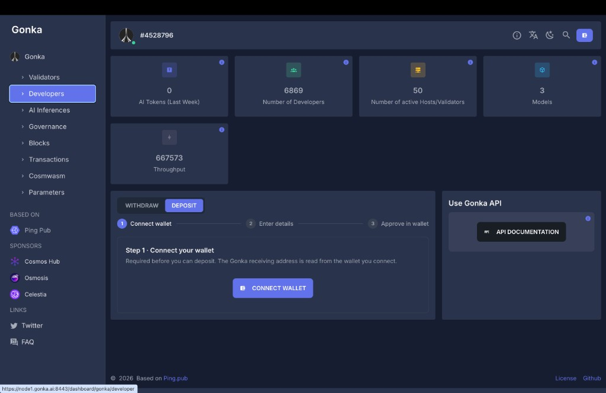</a>

### 连接您的 Keplr 钱包

确保选择 **存入** 切换按钮。点击 **连接钱包**。

将弹出一个包含可用钱包选项的对话框。选择 **KEPLR**。

<a href="/images/bridge_widget_3.png" target="_blank">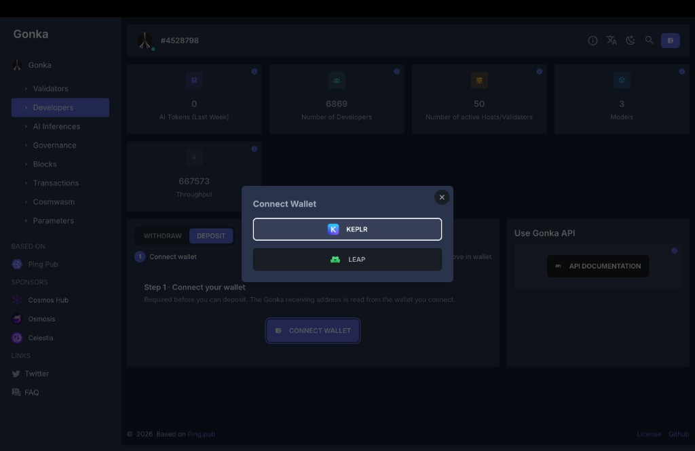</a>

!!! note "Keplr 显示“未安装”？"
    如果您看到“未安装”消息，您需要先安装 Keplr 浏览器扩展程序。请按照 [创建 Gonka 账户 → Keplr 浏览器扩展程序](../../wallet/create-account.md) 中的说明进行设置，然后返回此处。

    如提示，请输入您的 Keplr 密码。连接成功后，小工具将显示 **Keplr 已连接**，并显示您的缩短 Gonka 地址和 GNK 余额。点击 **继续** 以继续。

    <a href="/images/bridge_widget_4.png" target="_blank">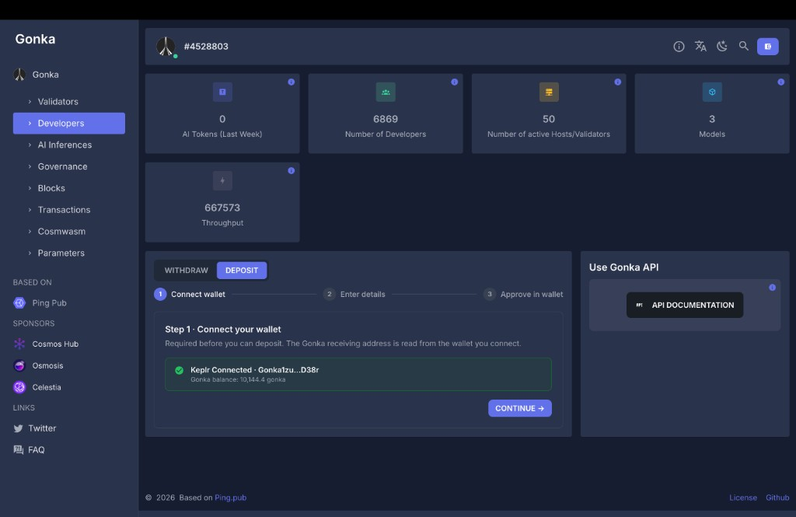</a>

!!! warning "助记词（种子短语）账户"
    如果您的 Gonka 账户是通过 **助记词**（种子短语）而非原始私钥创建的，桥接小工具将检测到地址不匹配并发出警告。这是因为以太坊和 Gonka 从同一助记词派生出 **不同的密钥**，因此代币将被发送到与您钱包当前显示不同的 `gonka1…` 地址。资金并未丢失——您可以从同一助记词中派生出匹配的密钥，但需要手动执行派生步骤。如果您看到此警告，请停止操作并阅读 [地址与密钥](addresses-and-keys.md) 后再继续。

### 选择代币和金额

在第 2 步中，从 **代币** 下拉菜单中选择您要存入的代币，并输入 **金额**。小工具将显示您当前的余额，**Gonka 上的接收地址** 将自动从您的已连接钱包填充。

小工具将显示预计的 **处理时间** 和 **近似费用**（费用货币取决于桥接类型——参见上表）。

=== "ERC-20 (USDC)"

<a href="/images/bridge_widget_5.png" target="_blank">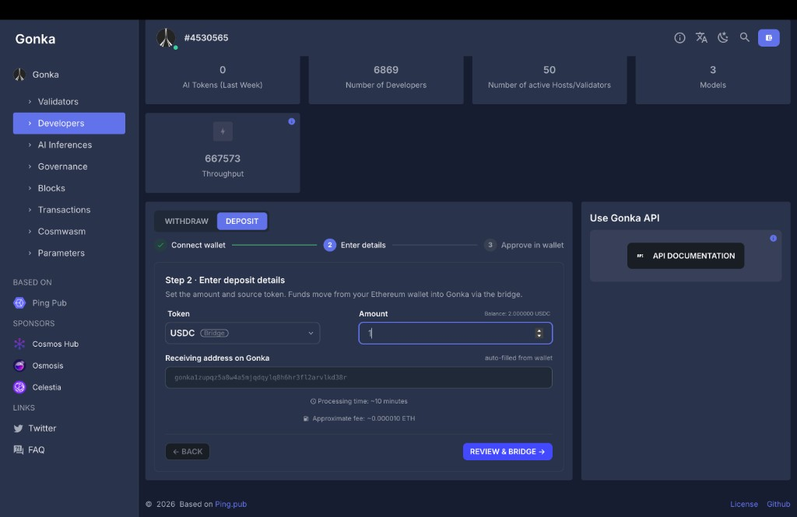</a>

=== "GNK"

<a href="/images/bridge_widget_20.png" target="_blank"></a>

=== "IBC (USDT)"

<a href="/images/bridge_ibc_deposit_1.png" target="_blank">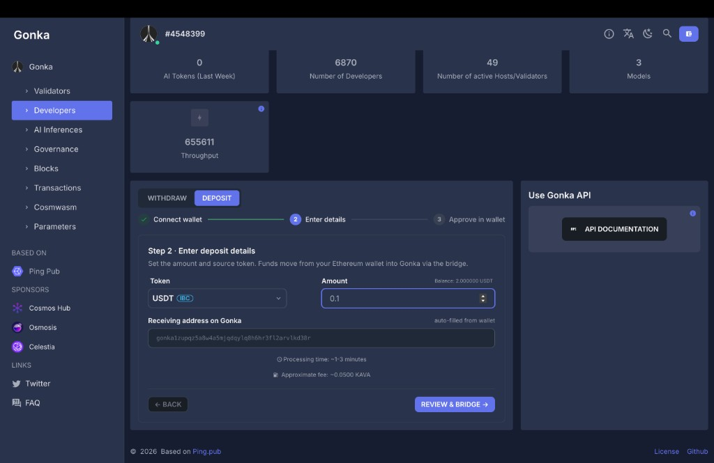</a>

点击 **审查并桥接**。

### 确认交易

您的钱包将打开一个**确认交易**屏幕。请仔细审查以下信息后再批准：

=== "ERC-20 (USDC)"

    - **代币和金额** — 确认正确的代币和金额。
    - **发送方** — 您的以太坊地址（发送者）。
    - **接收方** — 桥接合约地址（`0x972a7A92…648f2F68`）。这是预期的 — 您正在将代币发送至桥接合约，桥接合约随后将在 Gonka 上铸造包装代币。
    - **交易费用** — 您将支付的以太坊 Gas 费用。

<a href="/images/bridge_widget_6.png" target="_blank">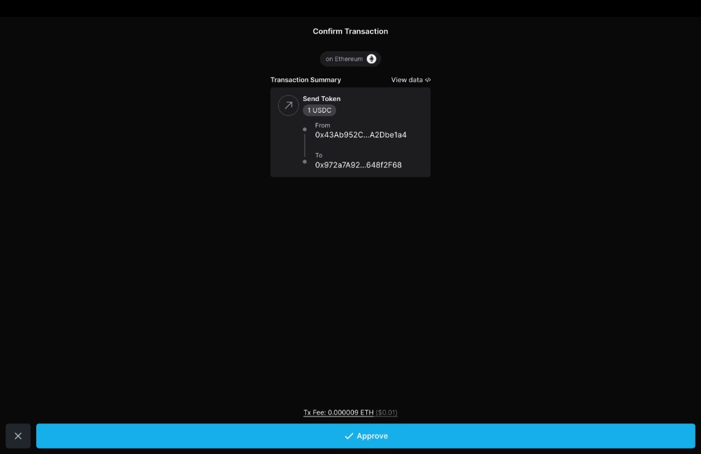</a>

=== "GNK"

    - **代币和金额** — 确认正确的代币和金额。
    - **接收方** — 桥接合约地址。
    - **交易费用** — 以太坊 Gas 费用。

<a href="/images/bridge_widget_21.png" target="_blank">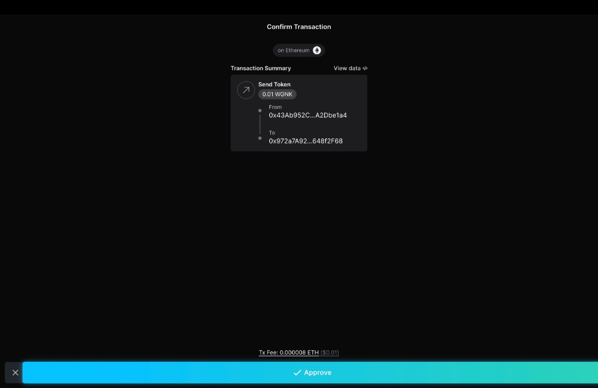</a>

=== "IBC (USDT)"

    - **消息类型** — `IBC Transfer`。
    - **金额和目标** — 例如：“通过 channel-161 发送 0.1 USDt 到 gonka1…”。
    - **交易费用** — 以 KAVA 支付（例如 0.05 KAVA）。

<a href="/images/bridge_ibc_deposit_2.png" target="_blank">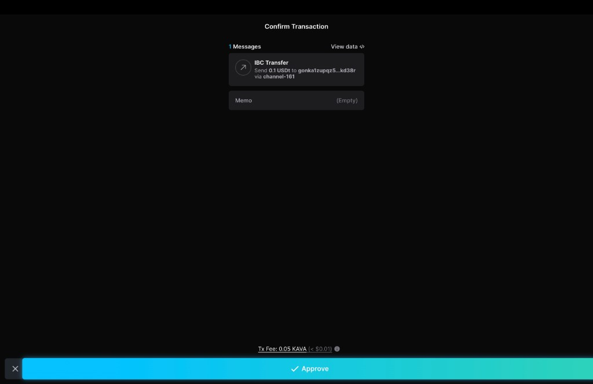</a>

点击 **批准** 提交交易。

!!! warning 
    确认前请仔细核对信息。桥接转账是**不可逆**的。如果发现任何错误，请点击 **✕** 取消并重新开始。

### 存款完成

小部件将显示一个**存款完成**屏幕，总结操作详情。

=== "ERC-20 (USDC)"

<a href="/images/bridge_widget_7.png" target="_blank">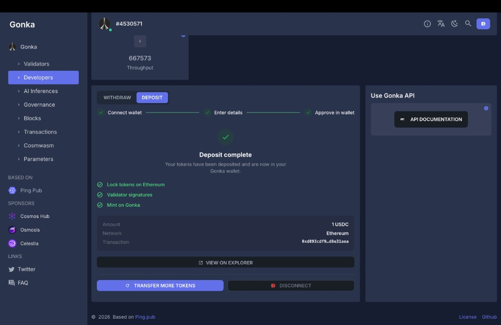</a>

=== "GNK"

<a href="/images/bridge_widget_22.png" target="_blank">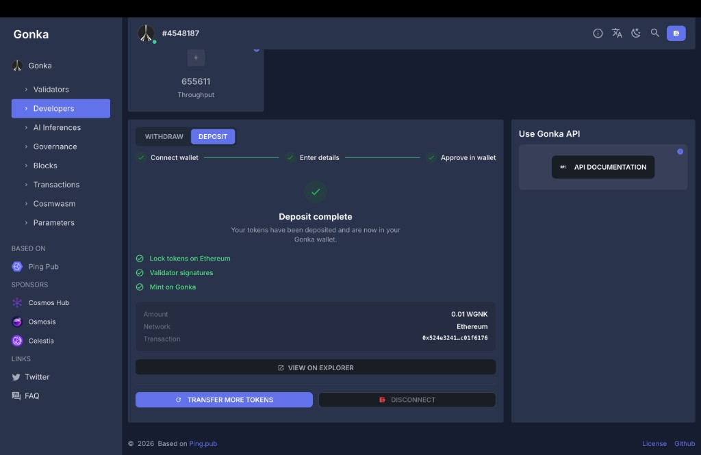</a>

=== "IBC (USDT)"

进度跟踪器显示：

    - **在钱包中批准转账** — 已完成
    - **IBC 数据包中继转账** — 已完成

<a href="/images/bridge_ibc_deposit_3.png" target="_blank">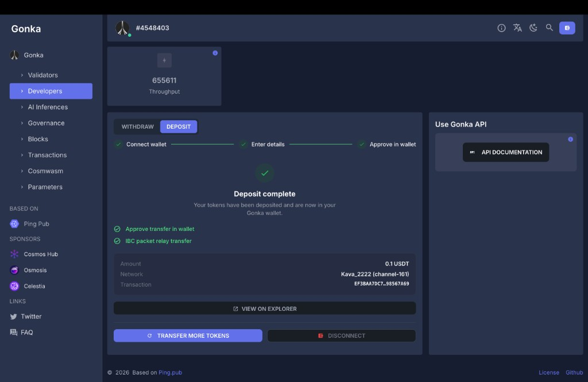</a>

从该屏幕您可以：

- 点击 **在浏览器中查看** 查看交易详情。
- 点击 **转移更多代币** 进行另一次存款。
- 点击 **断开连接** 断开您的钱包。

### 验证您的存款

您可以通过多种方式确认您的包装代币已到账：

- **在仪表板中**：打开 `https://node2.gonka.ai:8443/dashboard/gonka/account/<your_gonka_address>` 并检查您的余额。
- **通过存款完成页面上显示的交易链接**。
- **在 Keplr 中**：包装代币（CW-20）不会自动显示在 Keplr 中 — 请按照以下步骤手动添加。

---

### 将包装代币添加到 Keplr

包装的 ERC-20 代币（如 wUSDC 和 wUSDT）在 Gonka 链上是 CW-20 代币。Keplr 不会自动检测 CW-20 代币，因此您需要将其作为自定义代币添加。

!!! note 
    IBC 代币（通过 IBC 转移，而非以太坊桥）会自动显示在 Keplr 中。以下手动步骤仅适用于桥接包装的 CW-20 代币。

    **步骤 1**：打开您的 Keplr 钱包，点击右上角的菜单图标（三条水平线），然后选择 **管理资产列表**。

    <a href="/images/bridge_widget_12.png" target="_blank">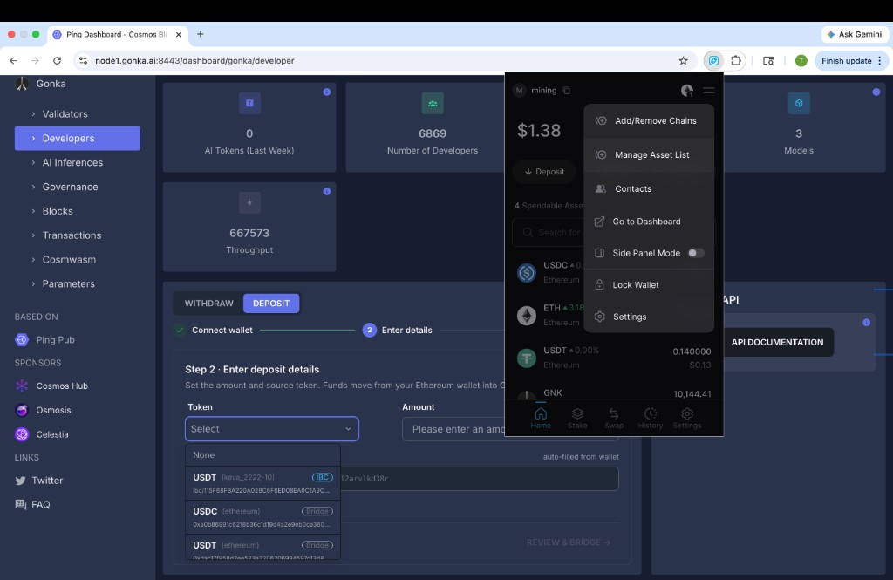</a>

    **步骤 2**：点击右上角的 **+** 按钮以添加自定义代币。

    <a href="/images/bridge_widget_13.png" target="_blank">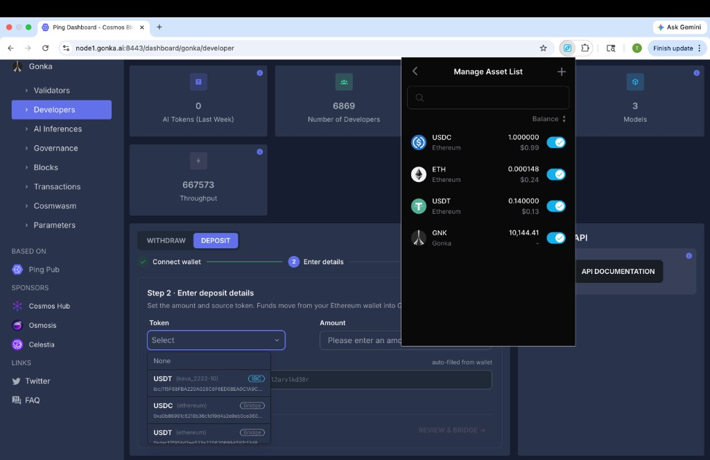</a>

    **步骤 3**：在 **添加自定义代币** 页面中，从链下拉菜单中选择 **Gonka**。将 CW-20 合约地址粘贴到 **合约地址** 字段中。代币元数据（名称、符号、小数位）将自动填充。点击 **确认**。

    已知合约地址：

| 代币 | Gonka 上的 CW-20 合约地址 |
|---|---|
| USDC | `gonka1fa83z7np903k9vh63guy82qthtv373d7vjeq0y7xeqh50rzn8vtssffkre` |
| USDT | `gonka15ggwj9un6qrmu4nj5ev6l7kpdcr00td03ff2mmj4cyhl8u8vjd2qnl3hgk` |

<a href="/images/bridge_widget_14.png" target="_blank">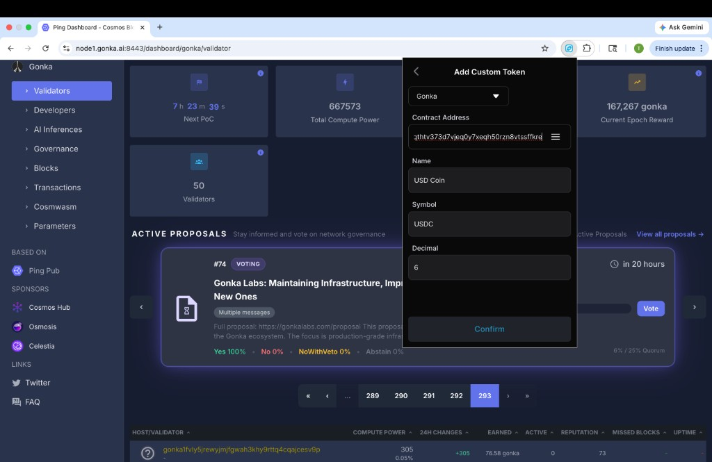</a>

**步骤 4**：完成 — 该代币现在将作为 **Gonka CW20** 代币显示在您的 Keplr 钱包中。

<a href="/images/bridge_widget_15.png" target="_blank">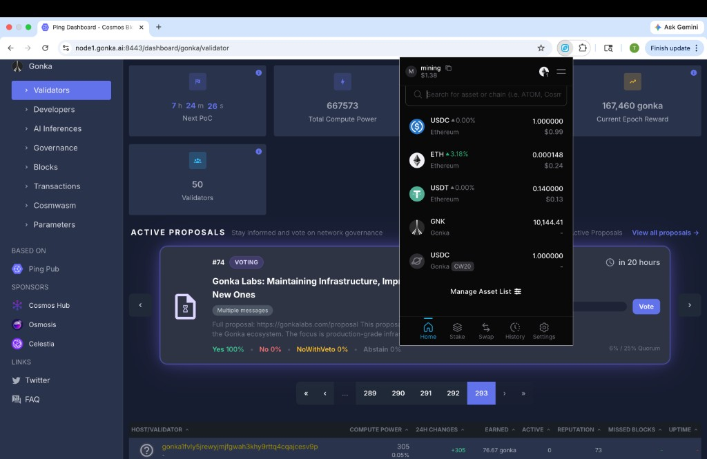</a>

---

## 从 Gonka 提现代币

本节将引导您使用桥接小工具从 Gonka 提现代币。从 **代币** 下拉菜单中选择代币 — 小工具将自动检测桥接类型：

* **ERC-20 代币** 和 **GNK** 通过 **以太坊桥** 进行。
* **IBC 代币**（USDT <span class="md-tag">IBC</span>，…）通过 **IBC** 转移到连接的 Cosmos 链。

### ETH / GNK 桥接提现的工作方式

1. **在 Gonka 上燃烧代币** — 包装代币在 Gonka 链上被燃烧（或原生 GNK 被锁定）。
2. **验证者签名** — Gonka 验证者生成 BLS 聚合签名以授权释放。
3. **在以太坊上释放** — 原始代币从以太坊上的桥接合约中释放（或 WGNK 被铸造）。

### IBC 提现的工作方式

1. **在钱包中批准转账** — 您在 Gonka 上签署一个 IBC 转账。
2. **IBC 数据包中继** — 数据包被中继到目标链。
3. **代币到账** — IBC 代币出现在目标链上的您的钱包中（例如 Kava）。

### 打开仪表板

在浏览器中打开一个创世节点：

- [https://node1.gonka.ai:8443](https://node1.gonka.ai:8443)
- [https://node2.gonka.ai:8443](https://node2.gonka.ai:8443)

在左侧边栏中导航到 **开发者** 部分。在桥接小工具中选择 **提现** 切换开关。

<a href="/images/bridge_withdraw_1.png" target="_blank">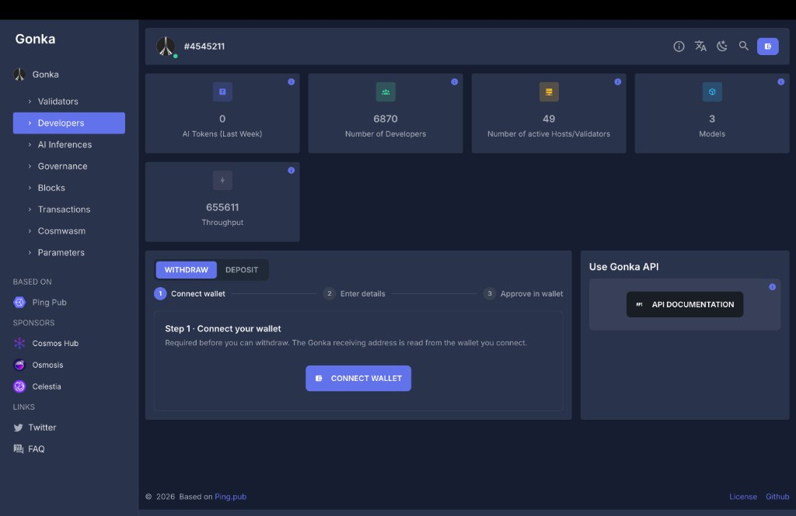</a>

### 连接您的 Keplr 钱包

确保选择了 **提现** 切换开关。点击 **连接钱包**。

将显示可用的钱包选项对话框。选择 **KEPLR**。

<a href="/images/bridge_withdraw_2.png" target="_blank">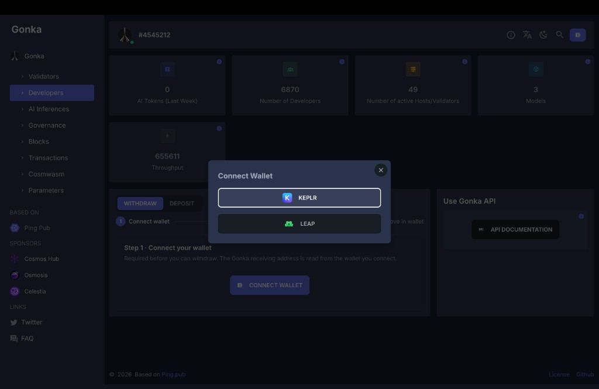</a>

!!! note Keplr 显示“未安装”？
    如果看到“未安装”消息，您需要先安装 Keplr 浏览器扩展程序。请按照 [创建 Gonka 账户 → Keplr 浏览器扩展程序](../../wallet/create-account.md) 中的说明进行设置，然后返回此处。

    如果提示，请输入您的 Keplr 密码。连接成功后，小部件将显示 **Keplr 已连接**，并显示您的缩短的 Gonka 地址和 GNK 余额。点击 **继续** 以继续。

    <a href="/images/bridge_withdraw_3.png" target="_blank">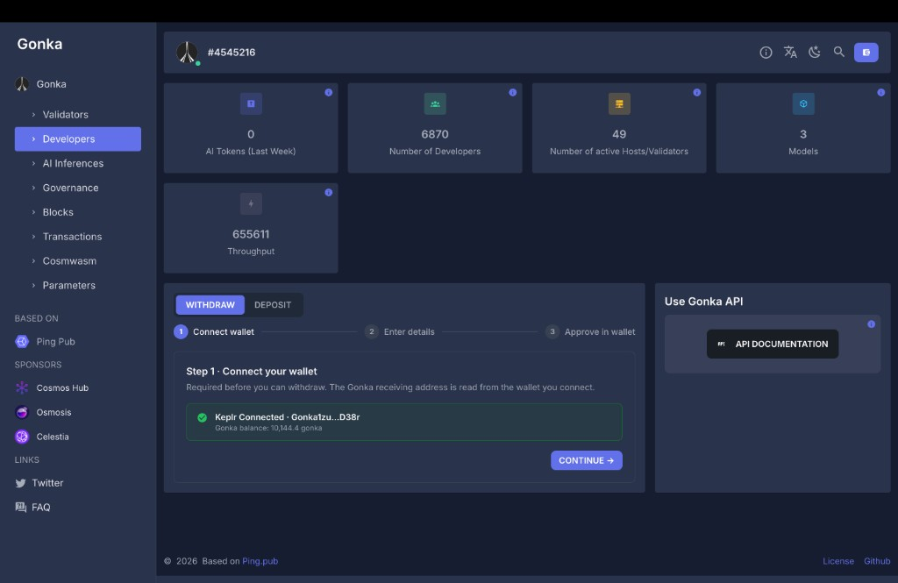</a>

!!! warning "助记词（种子短语）账户"
    如果您的 Gonka 账户是通过 **助记词**（mnemonic）而非原始私钥创建的，桥接小部件将检测到地址不匹配并发出警告。这是因为以太坊和 Gonka 从相同的助记词派生出 **不同的密钥**，因此代币将被释放到与您钱包当前显示不同的以太坊地址。资金并未丢失——您可以从同一助记词派生出匹配的密钥，但这需要手动派生步骤。如果您看到此警告，请停止操作并阅读 [地址和密钥](addresses-and-keys.md) 再继续。

### 选择代币和金额

在第 2 步中，从 **代币** 下拉菜单中选择您要提取的代币，并输入 **金额**。小部件会显示您在 Gonka 上该代币的当前余额。**目标地址** 会自动从您的已连接钱包填充。

!!! tip 
    与存款不同，您可以编辑目标字段以提取到其他地址。请确保这是您控制的地址，并且输入正确。

    === "GNK"

    <a href="/images/bridge_withdraw_4.png" target="_blank">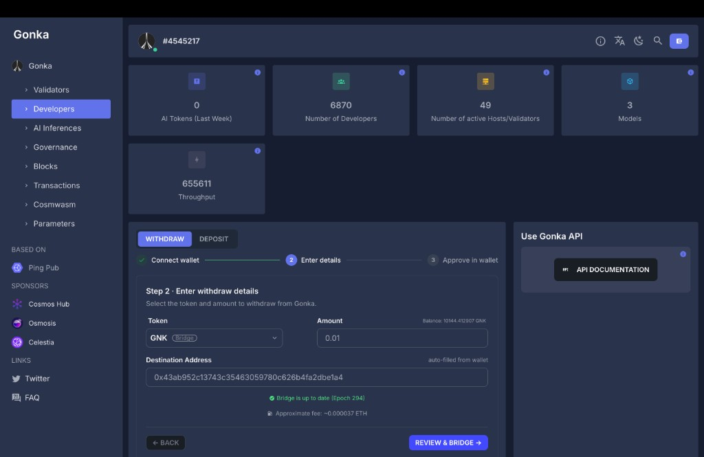</a>

    === "ERC-20 (USDC)"

    <a href="/images/bridge_withdraw_8.png" target="_blank">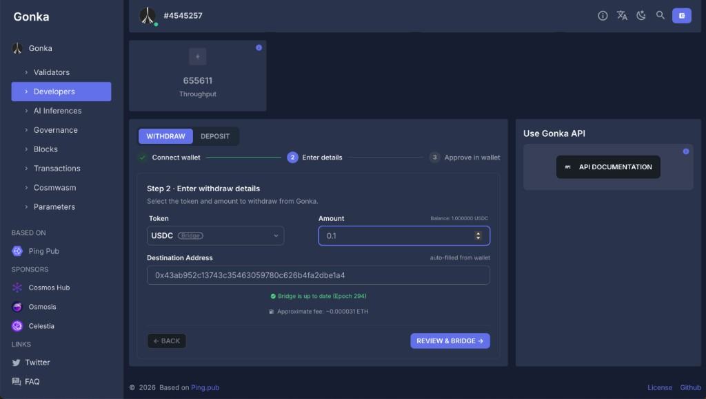</a>

    === "IBC (USDT)"

    目标地址是 Kava 链上的 `kava1…` 地址。处理时间约为 1–3 分钟。

    <a href="/images/bridge_ibc_withdraw_1.png" target="_blank">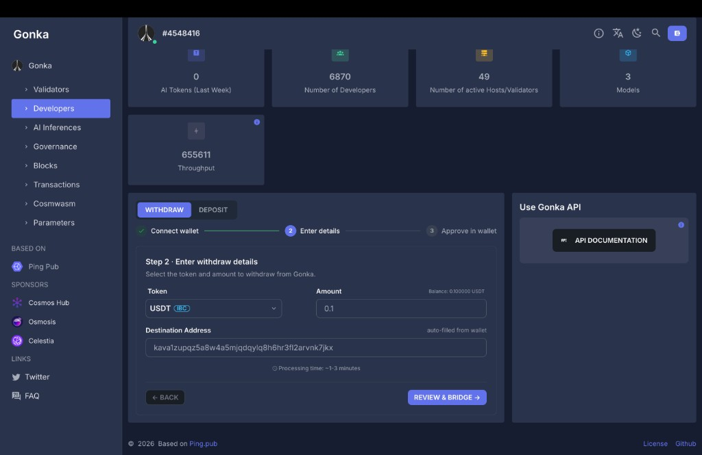</a>

    点击 **查看并桥接**。

### 在 Gonka 上确认交易

Keplr 将为 Gonka 链打开一个 **确认交易** 弹窗。检查详情后点击 **批准**。

=== "GNK"

    - **消息类型** — `MsgRequestBridgeMint`，用于在 Gonka 上锁定您的 GNK 并请求在以太坊上铸造 WGNK。
    - **交易费用** — 0 GNK。

<a href="/images/bridge_withdraw_5.png" target="_blank">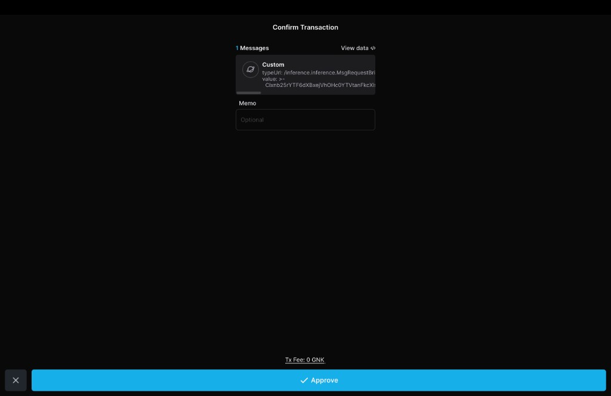</a>

=== "ERC-20 (USDC)"

    - **消息类型** — 对包装代币的 CW-20 合约执行 `Execute Wasm Contract` 调用，负载为 `withdraw`。
    - **交易费用** — 0 GNK。

<a href="/images/bridge_withdraw_9.png" target="_blank">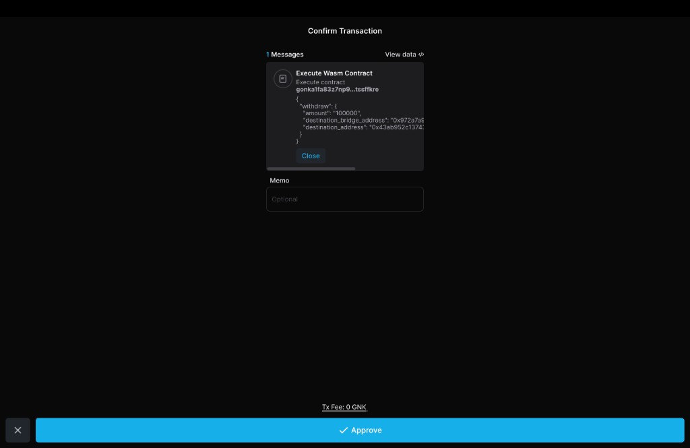</a>

=== "IBC (USDT)"

    - **消息类型** — `IBC Transfer`。
    - **金额和目标** — 例如：“通过 channel-5 向 kava1… 发送 0.1 USDt (Kava/channel-5)”
    - **交易费用** — 0 GNK。

<a href="/images/bridge_ibc_withdraw_2.png" target="_blank">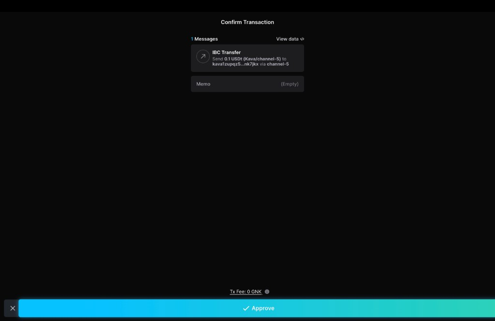</a>

!!! warning 
    确认前请仔细核对详情。桥接转账是 **不可逆** 的。如果发现任何错误，请点击 **✕** 取消并重新开始。

    对于 **ETH / GNK 桥接**：批准后，进度追踪器将标记 **在 Gonka 上燃烧代币** 为完成。Gonka 验证者随后自动收集并聚合其 BLS 签名（**验证者签名** 步骤）——此阶段您无需任何操作。

### 在以太坊上确认释放交易（仅限 ETH / GNK 桥接）

!!! note 
    此步骤仅适用于 **ETH 桥接** 和 **GNK 桥接** 的提现。对于 **IBC** 提现，第 4 步后转账自动完成——跳至第 6 步。

    当验证者生成 BLS 聚合签名（**验证者签名** — 已完成）后，Keplr 将打开第二个弹窗——这次是针对 **以太坊链**。此交易将执行桥接合约（`0x972a7a92…648f2f68`）以在以太坊上释放代币。

- **到** — Ethereum 上的桥接合约地址。
- **交易费** — Ethereum 燃料费（以 ETH 支付）。具体金额取决于当前的燃料价格。

=== "GNK"

<a href="/images/bridge_withdraw_6.png" target="_blank"></a>

=== "ERC-20 (USDC)"

<a href="/images/bridge_withdraw_10.png" target="_blank">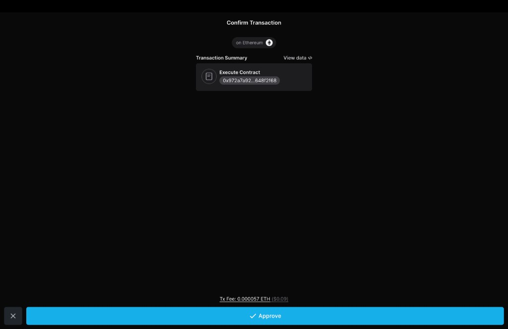</a>

点击 **批准** 以提交释放交易。

### 提现完成

小部件显示一个**提现完成**屏幕，所有阶段均已标记为完成。

=== "GNK"

<a href="/images/bridge_withdraw_7.png" target="_blank">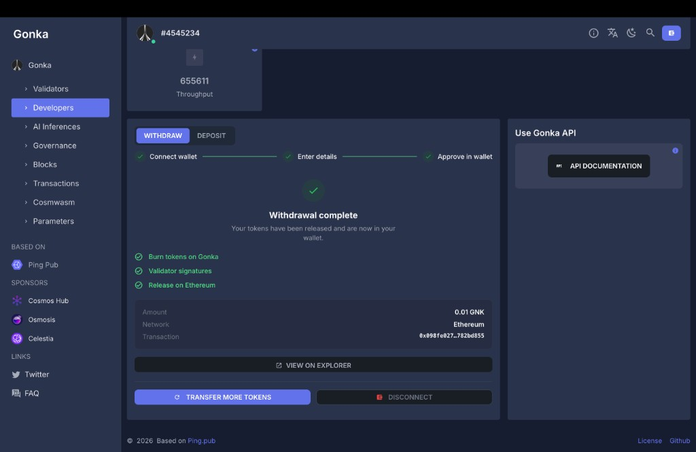</a>

=== "ERC-20 (USDC)"

<a href="/images/bridge_withdraw_11.png" target="_blank">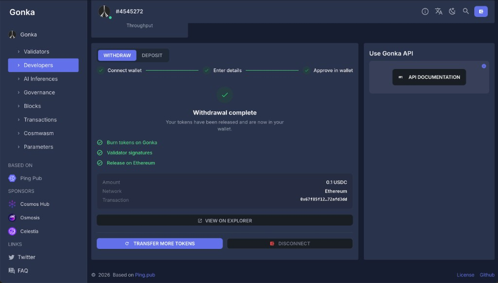</a>

=== "IBC (USDT)"

进度追踪器显示：

    - **在钱包中批准转账** — 已完成
    - **IBC 数据包中继转账** — 已完成

<a href="/images/bridge_ibc_withdraw_3.png" target="_blank">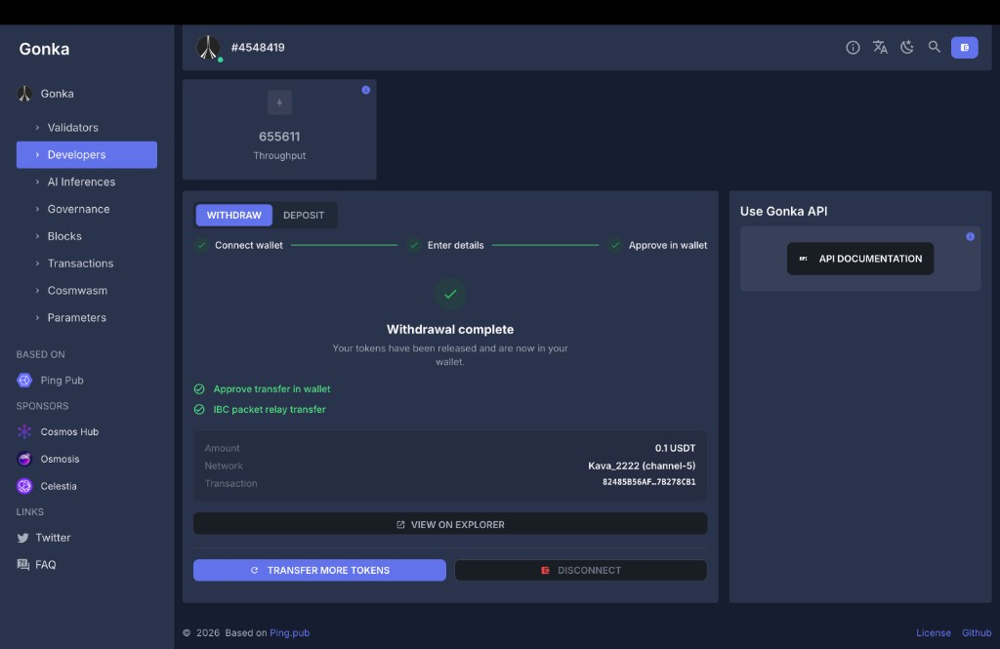</a>

从该屏幕您可以：

- 点击 **在浏览器中查看** 以查看交易详情。
- 点击 **转移更多代币** 以进行另一次提现。
- 点击 **断开连接** 以断开您的钱包。

### 验证您的提现

您可以通过多种方式确认您的代币已到账：

- **ETH 桥 / GNK**：检查您的 Ethereum 钱包中的已释放 ERC-20 代币或 WGNK。WGNK 会自动显示在 Keplr 中。
- **IBC**：检查目标链上的代币余额（例如 Keplr 中的 Kava 上的 USDT）。
- **浏览器链接**：使用提现完成屏幕上的 **在浏览器中查看** 链接。

<a href="/images/bridge_withdraw_12.png" target="_blank">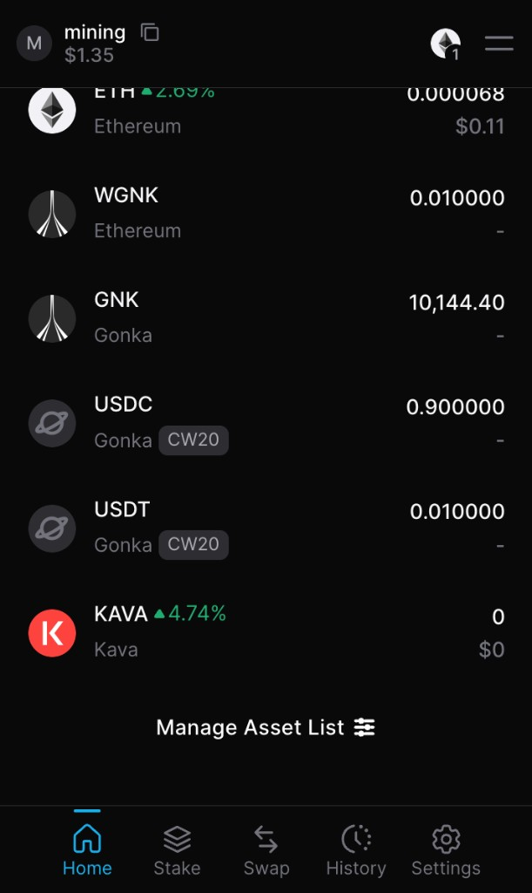</a>
